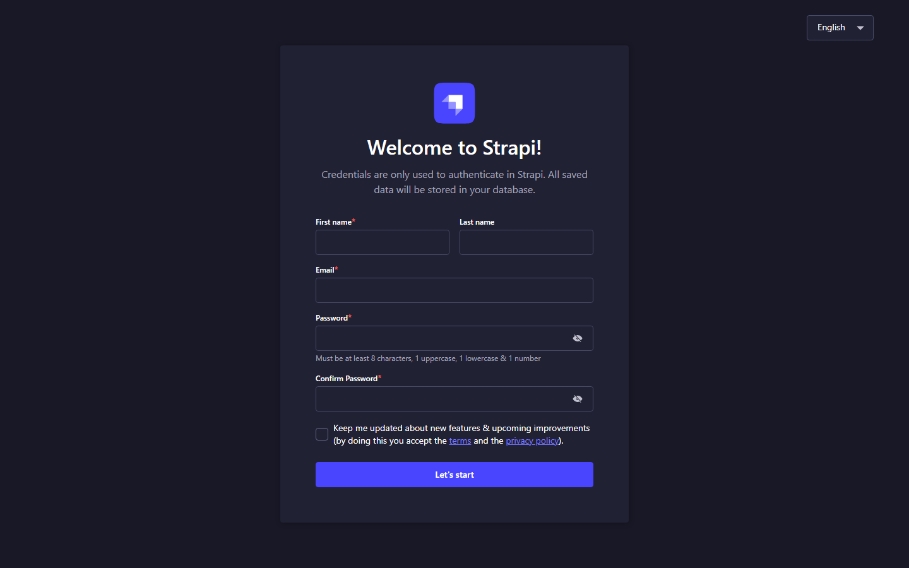

# Cheq — Headless E-Commerce Storefront (Strapi v5 + React 19 + Docker + AWS)

[](https://react.dev/)
[](https://strapi.io/)
[](https://www.typescriptlang.org/)
[](https://vitejs.dev/)
[](https://www.docker.com/)
[](https://tailwindcss.com/)
[](LICENSE)

An editorial, high-end luxury fashion storefront built with **React 19**, **Tailwind CSS v4**, and **GSAP scrollytelling**, powered by a **Strapi CMS v5** headless backend with containerized deployment for Docker and AWS.

---

## 📸 Application Previews

### 1. Luxury E-Commerce Storefront (React 19 + GSAP + Tailwind CSS)
*Live catalog rendering, smooth scrollytelling, and real-time inventory reservation connected to Strapi.*


### 2. Strapi CMS v5 Content Administration Panel
*Headless management of garments, collections, editorial journal, and customer reservations.*


---

## 🏛️ System Architecture

```text
       ┌────────────────────────┐
       │   Client Web Browser   │
       │   React 19 Storefront  │
       └───────────┬────────────┘
                   │
           REST API Requests
        (/api/garments, /reservations)
                   │
                   ▼
       ┌────────────────────────┐
       │     Strapi CMS v5      │
       │  Content & Media API   │
       │   (Port 1337 /admin)   │
       └───────────┬────────────┘
                   │
       ┌───────────┴────────────┐
       ▼                        ▼
 ┌───────────┐            ┌───────────┐
 │PostgreSQL │            │ S3 Media  │
 │ Database  │            │ Storage   │
 └───────────┘            └───────────┘
```

---

## 🚀 Quick Start (Local Development)

### Method A: One-Command Docker Stack (Recommended)
Make sure Docker Desktop is running:
```bash
docker compose up --build
```
* **Storefront:** [http://localhost:5173](http://localhost:5173)
* **Strapi Admin Panel:** [http://localhost:1337/admin](http://localhost:1337/admin)
* **PostgreSQL:** `localhost:5432`

---

### Method B: Standalone Node.js Development (No Docker Required)

#### 1. Start the Strapi v5 Backend:
```bash
cd backend
npm install
npm run db:embedded # Runs embedded PostgreSQL on port 5432
npm run develop
```
Strapi will automatically bootstrap:
* Pre-configured public REST permissions for `/api/garments` and `/api/reservations`.
* Pre-seeded with 6 luxury garment looks from the Autumn/Winter MMXXVI edit.

#### 2. Start the React Storefront:
In a separate terminal:
```bash
cd frontend
npm install
npm run dev
```
Open [http://localhost:5173](http://localhost:5173). The storefront will connect to Strapi at `http://localhost:1337`. If Strapi is offline, it gracefully falls back to the embedded catalog.

---

## 📦 Content Model Schema

| Collection Type | Endpoint | Key Fields | Purpose |
| :--- | :--- | :--- | :--- |
| **`Garment`** | `/api/garments` | `name`, `index`, `slug`, `subtitle`, `story`, `fabric`, `origin`, `edition`, `price`, `image` | Catalog looks and scrollytelling details |
| **`Collection`** | `/api/collections` | `title`, `season`, `intro`, `heroImage`, `garments` | Seasonal drops and lookbook edits |
| **`JournalPost`** | `/api/journal-posts`| `title`, `slug`, `eyebrow`, `intro`, `content`, `heroImage` | Editorial articles from the atelier |
| **`Reservation`** | `/api/reservations` | `customerName`, `customerEmail`, `customerPhone`, `garmentName`, `status` | Direct customer allocation leads |

---

## ☁️ AWS Production Deployment

1. **Frontend Hosting (S3 + CloudFront):**
   * Build the production bundle: `cd frontend && npm run build`.
   * Deploy `/dist` to an **Amazon S3** bucket configured for static web hosting.
   * Attach **AWS CloudFront** for global CDN caching and SSL.

2. **Strapi CMS (ECS Fargate + RDS):**
   * Deploy the Strapi container image (`backend/Dockerfile`) to **Amazon Elastic Container Service (ECS)** on AWS Fargate.
   * Attach an **Amazon RDS for PostgreSQL** database instance.
   * Configure `@strapi/provider-upload-aws-s3` for media assets upload directly to S3.

---

## 💼 Client Demonstration Scenario

1. **Storefront Presentation:** Load `http://localhost:5173`. Scroll through the GSAP horizontal lookbook and click a garment to view the inquiry modal.
2. **CMS Real-Time Update:** Open `http://localhost:1337/admin` in a side window. Edit *Look I: The Ivory Suit* — change edition from `32 garments` to `Only 4 pieces remain`. Hit **Publish**.
3. **Instant Storefront Sync:** Refresh the storefront to show live headless content rendering.
4. **Lead Capture:** Submit an inquiry via the "Inquire & Reserve with Strapi" modal button. Show the new reservation record generated in Strapi's dashboard.
